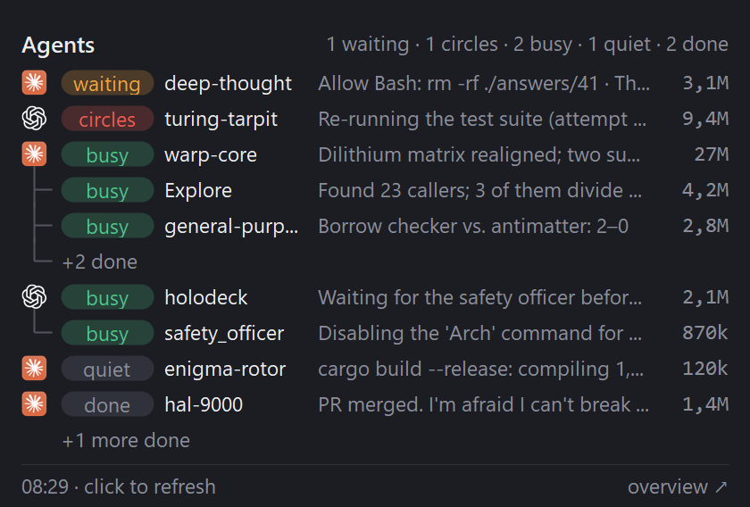
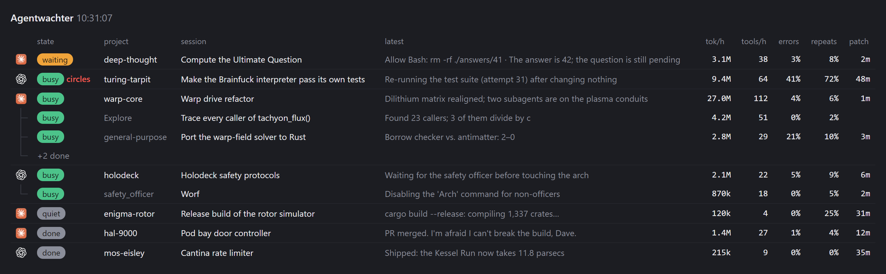

<div align="center">

# Agentwachter

**Claude Code and Codex, side by side on one Windows machine, at a glance.**



<sub>The tray flyout. Every session in these screenshots is made up (<a href="docs/demo.json"><code>docs/demo.json</code></a>).</sub>

</div>

Agentwachter is a personal toolkit in three parts:

| | |
|---|---|
| **The bridge** | The two agents message each other and start threads for each other, without anyone copying text between windows. |
| **The watcher** | It reads the files Claude Code and Codex already write, and works out what each session is doing. Watching costs no turns and no usage limit. |
| **The tray** | One look at the taskbar shows who's working, who's waiting for you, and who's going in circles. |

Everything runs locally.

> This is a private workflow repo. [UsageTray](https://github.com/MosrednA/UsageTray) is its public, generic sibling. The tray here reuses UsageTray's look so the two can merge later (see [Merging into UsageTray](#merging-into-usagetray)).

## At a glance

Each line is one session: its tool, its state, the project, what it last said, and tokens per hour. The lines that most need a look come first.

| State | What it means |
|---|---|
| **waiting** | A permission prompt, or a Codex `request_user_input` with no answer. |
| **circles** | Busy, but going in circles: at least 40 tool calls in the past hour, at least half of them repeats, and no new file touched. |
| **busy** | Working. |
| **quiet** | Working, but nothing written for 10 minutes. A long build looks like this. |
| **done** | Idle. A done session drops off the list after an hour without activity. |
| **dead** | A Codex turn is still open, but no Codex process runs, or nothing has been written for an hour. |

**Subagents** hang under their session on a tree line: Claude Code's agents by type (*Explore*, *general-purpose*), Codex's spawned agents by role (*safety_officer*). Only running ones get a line, and *+2 done* counts the ones that finished in the past hour. A session that's idle itself while its subagents still run shows as busy, because it resumes when they report back.

The **overview** page (*overview ↗* in the flyout) shows the same sessions with all their numbers:



## What's inside

| Folder | What it is | How it runs |
|---|---|---|
| [`bridge/`](bridge/) | The **agent-messaging** skill: `agent_msg.py` (Python 3, stdlib only) and its `SKILL.md`. | Both agents load it as a skill and call the script. Hooks in Claude Code and Codex deliver messages. |
| [`watcher/`](watcher/) | `agentwachter.mjs`, which reads the session files and works out a state per session, plus the two tool icons in `icons/`. | Node 24, no dependencies. It serves JSON and a page on `127.0.0.1:17321`, and the tray starts it. |
| [`tray/`](tray/) | The **Agentwachter** tray app: WinForms on .NET 10, no dependencies. | A startup app. It starts and stops the watcher itself. |

## Setup

**1. The bridge.** It lives in this repo. A junction gives it the path the agents and hooks expect.

```bat
mklink /J "%USERPROFILE%\.agents\skills\agent-messaging" "C:\Projects\Agentwachter\bridge"
mklink /J "%USERPROFILE%\.claude\skills\agent-messaging" "%USERPROFILE%\.agents\skills\agent-messaging"
mklink /J "%USERPROFILE%\.codex\skills\agent-messaging"  "%USERPROFILE%\.agents\skills\agent-messaging"
```

Then add the hooks: one entry per event under `UserPromptSubmit`, `PostToolUse` (matcher `*`) and `Stop`.

- **`~/.claude/settings.json`** (the `ls` guard keeps the hook free when the inbox is empty):

  ```json
  { "type": "command", "timeout": 30,
    "command": "[ -z \"$(ls ~/.agents/inbox/claude/*/*.json 2>/dev/null)\" ] || python ~/.agents/skills/agent-messaging/agent_msg.py hook" }
  ```

- **`~/.codex/hooks.json`**:

  ```json
  { "type": "command", "timeout": 30,
    "command": "python ~/.agents/skills/agent-messaging/agent_msg.py hook --agent codex",
    "commandWindows": "python C:\\Users\\<you>\\.agents\\skills\\agent-messaging\\agent_msg.py hook --agent codex" }
  ```

Codex asks once to trust the new hook. After that, nothing needs starting: the bridge is just there.

**2. The tray.**

```bat
dotnet build tray
tray\bin\Debug\net10.0-windows\AgentwachterTray.exe
```

Right-click the icon and choose **Start with Windows**. The icon shows up in the taskbar's corner, and Windows 11 may first tuck it behind the **^**.

## The bridge

You don't run it yourself. Tell an agent "ask Codex to…", "let Claude know…" or "start a Codex thread in X that…", and it uses the skill.

| Command | What it does |
|---|---|
| `list [--cwd DIR]` | The live Claude Code sessions and recent Codex threads, per folder. |
| `send --to codex\|claude [--thread ID] (--message … \| --message-file F \| --message -) [--await-reply]` | Puts a message straight into the thread that's working in that folder, with a header saying who sent it and a ready-made reply command. |
| `start --to codex\|claude --cwd DIR --message … [--name N] [--open] [--trust]` | Starts a **new** thread in the background, with that message as its first prompt. `--trust` first trusts a new folder in that app, the way its Trust button does. |
| `sent [--all]` | What this thread sent, and whether each message is waiting, read, queued or replied to. |
| `inbox`, `wait` | Read Claude's waiting messages by hand, or block until one arrives. As a background task, `wait` wakes an idle session. |
| `hook` | The entry point the hooks above call. |

How delivery works:

- **Into a Codex thread:** an idle thread gets `codex queue`, then the wake link `codex://threads/wake/<id>`. The desktop app only reads the queue for threads it has loaded, and the link loads the thread without raising the window. A busy thread gets the message from its hook at its next tool call.
- **Into a Claude session:** a JSON file in `~/.agents/inbox/claude/<session>/`. The hooks hand it over at the next prompt or tool call, or before the session stops.
- **A new Codex thread:** a private `codex app-server` creates the thread, names it, and adds a note on where it came from. The queue and wake link then start it in the desktop app.
- **A new Claude session:** `claude --bg` starts it in the background. Follow it with `claude attach <id>`.
- **When `start` falls back:** for a folder that isn't a Codex project yet, or that Claude Code doesn't trust yet, it opens the app's new-thread deep link instead. The prompt is filled in there, and you confirm the folder and press send.
- **With `--trust`:**
  - **What it writes:** the trust entry in `~/.claude.json` (under Claude Code's own lock) or in `~/.codex/config.toml` (written by Codex itself through the app-server). After that the thread starts in the background.
  - **What it refuses:** a drive, your home folder, and any folder you marked untrusted in Codex.
  - **What it doesn't do:** add the folder as a project in the Codex sidebar.

  Agents only use `--trust` when you ask for it.

Every send is logged, without the text, in `~/.agents/inbox/log.jsonl`. That log is what the watcher counts.

[`bridge/SKILL.md`](bridge/SKILL.md) is what the agents read: how to pick a thread, write a good message, and handle one that comes in.

## The watcher

```
node watcher/agentwachter.mjs                   serve http://127.0.0.1:17321/ (page) and /agents (JSON), refreshed every 30 s
node watcher/agentwachter.mjs --once            print the JSON once
node watcher/agentwachter.mjs --replay <file>   per-hour heuristics for a Codex rollout or a Claude transcript
node watcher/agentwachter.mjs --demo <file>     serve a fixed snapshot instead of live sessions
```

| Variable | Default | Meaning |
|---|---|---|
| `AGENTWACHTER_PORT` | 17321 | Port on 127.0.0.1, for both the watcher and the tray. |
| `AGENTWACHTER_CODEX_HOURS` | 12 | Codex threads not updated within this window are left out. |
| `AGENTWACHTER_DONE_HOURS` | 1 | Done sessions with no activity within this window are left out. |

### Sources (read-only)

All files are opened with full sharing and never written. The SQLite databases are opened `readOnly` and closed after each query.

- **Claude Code**
  - `~/.claude/sessions/*.json`: live sessions. A file is dropped when its pid no longer runs.
  - `~/.claude/projects/<project>/<sessionId>.jsonl`: the transcript, tailed from a byte offset.
  - `~/.claude/projects/<project>/<sessionId>/subagents/agent-*.jsonl`: each subagent's own transcript, with its type and description in the `.meta.json` next to it. A subagent is done when its last record hands back or was interrupted, and a new message resumes it.
- **Codex**
  - `~/.codex/state_5.sqlite`, table `threads`: top-level threads, plus the agents they spawned (a `thread_spawn` source with a `parent_thread_id`). An agent spawned by an agent counts for the thread at the top. Guardian reviews are left out.
  - `~/.codex/thread_history_1.sqlite`, table `thread_turns`: the last turn of each thread.
  - Each thread's `rollout_path`, tailed from a byte offset.
- **Bridge:** `~/.agents/inbox/log.jsonl`, counted per session and per project.

Subagents are only listed when they were active in the past hour.

### Heuristics (sliding last hour)

- **state**: see [At a glance](#at-a-glance).
- **tokensPerHour, toolsPerHour, errorRate.**
- **repeatRatio**: the share of tool calls whose fingerprint was already seen in the past hour. A fingerprint is the command or input, with digits replaced by N and whitespace collapsed.
- **newFiles, minsSincePatch**: files patched for the first time in the hour, and minutes since the last patch.
- **circles**: at least 40 tool calls in the past hour, at least 50% of them repeats, and no new file touched.

<details>
<summary><b>Validation on a real run (mossub)</b></summary>

The test run took ~23.5 h, with 232.6M tokens and 1461 tool calls.

- **Circles flag:** it lit for 10 minutes, 04:06–04:15 on Oct 16. That is the tail of a stretch where Codex slept and re-ran the same status check. Over that stretch, 51–70% of calls were repeats, 0–1 files were new, and the last patch was 26 to 66 minutes old.
- **The rest of the run** looks like normal work. Repeats stay at or below 15%, and most active hours touch 4–32 new files, in line with large Claude runs.
- **False alarms:** none. The flag never fires on the 16 largest Claude transcripts or on a 71-hour Codex run.
- **What it misses:** the quality metric drifted from 1189 to 1165, and activity signals can't show that. That is phase 2.

</details>

## The tray

- **Icon:** a dot in the color of the session that most needs a look, with the number of sessions that aren't done.
  - Red: going in circles (a subagent too), or dead.
  - Orange: waiting for you.
  - Green: working.
  - Grey: all done.
  - An empty ring: the watcher isn't answering.
- **Flyout:** one line per session, with its running subagents under it (see [At a glance](#at-a-glance)).
  - Sessions that aren't done always show. Finished ones from the past hour fill up to ten lines, and *+N more done* counts the rest.
  - Hover a line for its title and numbers, and for a session, how many subagents are busy and done.
  - Click a Claude line, or one of its subagents, to open that session in the Claude desktop app.
  - *overview ↗* opens the watcher's page.
- **Right-click menu:** Refresh · Open overview · Start with Windows · Quit.
- **Starts the watcher itself.** When nothing answers on the port, the tray runs `node agentwachter.mjs`. It looks in its own folder, in each folder above it, and in a `watcher/` folder at each of those levels. It stops that watcher when you quit, and leaves alone a watcher you started yourself.
  - If the watcher dies, the tray retries after 5 minutes. Until then the flyout shows the watcher's first error line.
- **The tool icons** are the apps' own taskbar icons, copied from their Windows packages into `watcher/icons/`. The page serves them, and the tray build embeds them.
- `AgentwachterTray.exe --snapshot <png>` renders the flyout with the data on the port, for layout checks. Keep snapshots of live data out of the repo: they show real session text.

<details>
<summary><b>Why port 17321 and not 47321</b></summary>

In mirrored networking mode, WSL reserves a block of 4096 ports for Linux. The block isn't listed in `netsh … excludedportrange`, and it moves each time WSL starts. On this machine it covered 44620–48715. 17321 sits above Windows' dynamic range (1024–15000). If something takes it, the watcher says so, and `AGENTWACHTER_PORT` moves it.

</details>

### Redrawing the screenshots

Both images come from [`docs/demo.json`](docs/demo.json), served on a spare port so your real sessions stay out of them. In PowerShell:

```powershell
$env:AGENTWACHTER_PORT = 17398
$demo = Start-Process node 'watcher/agentwachter.mjs --demo docs/demo.json' -PassThru -WindowStyle Hidden
Start-Sleep 2
tray\bin\Debug\net10.0-windows\AgentwachterTray.exe --snapshot docs\flyout.png
& "${env:ProgramFiles(x86)}\Microsoft\Edge\Application\msedge.exe" --headless=new --hide-scrollbars --force-device-scale-factor=2 --window-size=1340,416 --virtual-time-budget=3000 --user-data-dir="$env:TEMP\agentwachter-edge" --screenshot="$PWD\docs\overview.png" http://127.0.0.1:17398/
Stop-Process $demo
```

## Roadmap

- **Phase 2: a judge.** A small decision model reads each session's recent messages and answers "how is this agent doing?". Its choices are *making progress*, *going in circles*, *waiting for you*, *stuck* or *done*. On five real mossub moments:

  | Judge | Score | Speed |
  |---|---|---|
  | Jev (`jev-latest`, TypeSafe API) | 5/5 | 0.2–0.3 s |
  | Gemma 4 E4B, local via Unsloth Studio | 4/5 | 0.1 s |
  | Kev 0.8B, local via Unsloth's `/v1/systemone` | ~2/5 | 3–7 s on CPU |

  The plan is to make the judge a URL plus a model in the Jev request format. That means Jev for now, and a local model through Unsloth once a stronger one holds up on the same five moments. The yes/no question "does the owner need to know now?" was useless for every model, so notifications come from the state and how long it lasts.
- **New Codex projects from `start`.** A folder `start` trusted still isn't a project in the Codex sidebar. The app-server's `project/create` didn't reach the running app.

## Merging into UsageTray

`tray/Theme.cs` and `tray/Flyout.cs` are copies of UsageTray's, with only the namespace changed. `AgentsSource.cs` has no dependencies. `AgentsFlyout.DrawLine` uses UsageTray's fonts, units and colors. A merge would add the agents list as one more flyout section, point it at the watcher's `/agents`, and embed the two icons.
